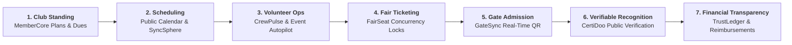
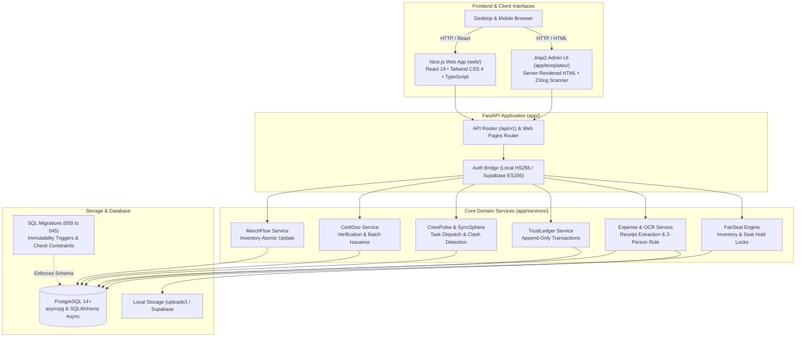
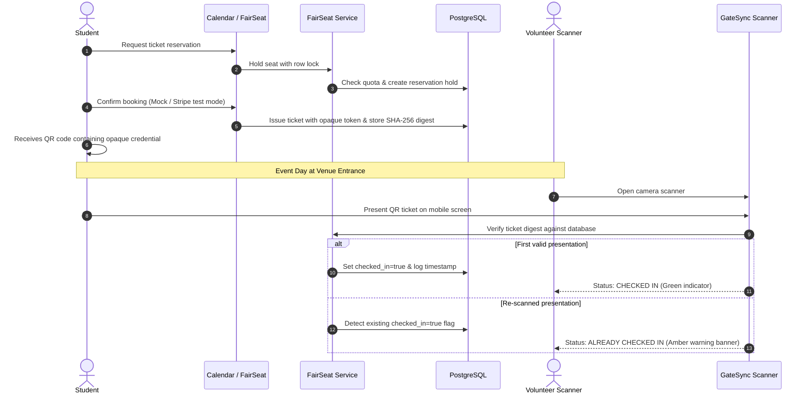

<div align="center">

# WHODOO
### *Your campus. One platform.*

<p align="center">
  
</p>

<p align="center">
  
</p>

<p align="center">
  <strong>The all-in-one extracurricular operations platform for college student organizations.</strong><br />
  Event operations • Volunteer intelligence • Immutable double-entry ledger • Concurrency-safe ticketing • GateSync QR check-in • CertiDoo verification • Official club store
</p>

<p align="center">
  <a href="#-the-solution-whodoo"><strong>Overview</strong></a> •
  <a href="#-key-modules--unique-selling-propositions"><strong>Modules</strong></a> •
  <a href="#-inside-whodoo--visual-walkthrough"><strong>Visual Walkthrough</strong></a> •
  <a href="#-verified-architecture"><strong>Architecture</strong></a> •
  <a href="#-verified-tech-stack"><strong>Tech Stack</strong></a> •
  <a href="#-quickstart"><strong>Quickstart</strong></a> •
  <a href="#-testing--verification"><strong>Tests</strong></a> •
  <a href="#-reviewer--hackathon-demo-script-2-minutes"><strong>Demo Script</strong></a> •
  <a href="#-the-team"><strong>Team</strong></a>
</p>

---

<p align="center">
  
</p>

</div>

---

## 📌 The Problem

College student organizations are the heartbeat of campus culture, yet their day-to-day operations are fragmented across chaotic, disconnected tools:

- **Lost Accountability & Budget Chaos:** Registrations live in unorganized Google Forms, expense receipts get buried in WhatsApp chats, and cash or UPI dues lack traceable, immutable ledger records.
- **Volunteer Coordination Breakdowns:** Organizers struggle to track who is assigned to which duty, leading to double-booked venues, overlooked preparations, and last-minute panic.
- **Ticketing & Gate Admission Fraud:** Shared screenshots of confirmation emails and static QR codes cause duplicate admissions and overcrowding at auditorium doors.
- **Lost Institutional Memory:** When senior club officers graduate each year, hard-won operational knowledge, vendor contacts, and previous event notes vanish into personal drives.
- **Unverified Paper Certificates:** Participation and achievement certificates are manually typed into design tools, making them difficult to issue at scale and impossible for recruiters or administrators to verify.

---

## 💡 The Solution: WhoDoo

**WhoDoo unifies the entire student organization lifecycle into a single, cohesive campus operating system.**

Instead of duct-taping spreadsheets to chat apps, WhoDoo connects **campus event discovery**, **volunteer task dispatch with blocker escalation**, an **auditable financial ledger with receipt OCR**, **concurrency-locked ticket reservations**, **real-time camera QR admission**, **cryptographically verifiable certificates**, and an **official club merchandise store**.

### The WhoDoo Operational Lifecycle



```
   ┌────────────────────────────────────────────────────────────────────────┐
   │                            WHODOO ECOSYSTEM                            │
   ├──────────────────┬───────────────────────────────┬─────────────────────┤
   │    STUDENTS      │      VOLUNTEERS & LEADS       │   CLUB LEADERSHIP   │
   │  • Discovery     │  • CrewPulse Task Board       │  • President        │
   │  • FairSeat      │  • Crew Review Clash Guard    │  • Treasurer        │
   │  • GateSync QR   │  • SyncSphere Clash Detection │  • TrustLedger P&L  │
   │  • CertiDoo View │  • GateSync Scanner           │  • Snap Approvals   │
   │  • Club Store    │  • Snap-to-Reimburse OCR      │  • LegacyVault      │
   └──────────────────┴───────────────────────────────┴─────────────────────┘
```

---

## 🚀 Key Modules & Unique Selling Propositions

Every capability in WhoDoo is implemented, tested, and grounded in verified code:

| Module / USP | What It Does | Verified Implementation |
|---|---|---|
| **MemberCore** | Manages club membership plans (Annual, Semester, Honorary), dues status, automatic expiration, renewal reminders, and member ticket discounts. | `app/services/membership_service.py`<br />`migrations/031_membercore_memberships.sql` |
| **WhoDoo Connect** | Role-targeted announcement hub broadcast to everyone, members, volunteers, officers, or single-event crews, with unread tracking and pinned alerts. | `app/services/announcement_service.py`<br />`app/templates/announcements.html` |
| **LegacyVault** | Preserves institutional memory through role-scoped handover notes (President, Treasurer, Leads, Volunteers) with immutable version history on every edit. | `app/services/handover_service.py`<br />`app/templates/handover.html` |
| **Public Calendar** | Multi-club campus event discovery grid where any student can explore upcoming dates, inspect venue details, and register without an initial account. | `app/web/public_pages.py`<br />`app/templates/public/events.html` |
| **CrewPulse** | Volunteer task tracking with deadlines, critical priority flags, blocker reporting, and full status trails (`todo` → `in_progress` → `blocked` → `done`). | `app/services/task_service.py`<br />`migrations/011_crewpulse.sql` |
| **Crew Review** | Detects duplicate volunteer assignments, overlapping shifts, and multi-event duty clashes, logging auditable organizer override reasons for exceptions. | `app/services/assignment_review.py`<br />`app/web/member2_pages.py` |
| **Event Autopilot** | Calculates a deterministic 0–100 event readiness score from live task statuses, blocked items, and venue clashes, explaining point deductions transparently. | `app/services/autopilot.py`<br />`app/services/event_service.py` |
| **SyncSphere** | Detects double-booked halls and overlapping lead schedules within the club, providing conflict-free alternative time slots with 1-click **Move here** reschedule. | `app/services/syncsphere.py`<br />`app/services/event_service.py` |
| **FairSeat** | Ticket reservation engine with strict row-level database locking, seat quota partitions, hold timers, and dynamic member discount calculations. | `app/services/fairseat_service.py`<br />`app/services/fairseat_pricing.py` |
| **GateSync** | In-browser camera QR code scanner with offline fallback, ticket redemption API, SHA-256 digest checks, and instant duplicate admission rejection. | `web/src/modules/gatesync/`<br />`app/static/door.js` |
| **CertiDoo** | Verifiable A4 printable and digital certificates issued from door attendance, completed tasks, or achievements, verifiable publicly via `/verify/<code>`. | `app/services/certificate_service.py`<br />`app/templates/certificates.html` |
| **Snap-to-Reimburse** | Volunteer receipt upload with Tesseract OCR extracting vendor, date, and amount; enforces a strict two-person approval rule for claims ≥ ₹1,000. | `app/services/expense_service.py`<br />`app/services/ocr_service.py` |
| **TrustLedger** | Immutable append-only double-entry financial ledger recording income, expense claims, ticket proceeds, merchandise revenue, and event profit & loss. | `app/services/ledger_service.py`<br />`migrations/001_ledger.sql` |
| **MerchFlow** | Official club store featuring member-exclusive pricing, live variant stock tracking, and database constraints preventing overselling. | `app/services/merch_service.py`<br />`migrations/003_merch.sql` |

---

## 📸 Inside WhoDoo — Visual Walkthrough

### 1. Campus Event Discovery & Public Calendar
> *Every club’s upcoming events in one unified, public schedule. Students browse what is on, pick a date on the monthly grid, view venue details, and register without needing an initial account.*

<p align="center">
  
</p>

*Above: The interactive monthly calendar on the WhoDoo landing page, enabling instant event discovery across all student clubs on campus.*

---

### 2. One Platform, Scoped Responsibilities
> *WhoDoo mirrors the real hierarchy of campus organizations: President, Treasurer, Event Leads, Members, and Volunteers. Each role receives dedicated views, scoped operational permissions, and transparent approval boundaries.*

<p align="center">
  
</p>

*Above: Role-based hierarchy tree at sign-in, enforcing precise access controls across leadership, organizers, and volunteers.*

---

### 3. From Booking to the Door: GateSync QR Check-in
> *Tickets are validated in real time at event entry. GateSync activates the device camera, parses the cryptographic ticket digest, updates the live attendance counter, and immediately flags repeat check-in attempts to eliminate pass-backs.*

<p align="center">
  
</p>

*Above: A live scan in CS Lab 2 detecting a duplicate scan attempt (`Already checked in — WD-K6Q5BV`), preserving gate integrity while maintaining a real-time guest arrival log.*

---

### 4. CertiDoo: Recognition That Can Be Verified
> *WhoDoo extends beyond event attendance. CertiDoo allows authorized club officers to issue digital certificates for eligible participants, volunteers, and achievements. Each certificate carries a distinct verification code and QR credential that anyone can authenticate against WhoDoo's records without logging in.*

<p align="center">
  
</p>

*Above: An authentic Certificate of Achievement issued to Rohan Mehta for the 'Best Project Award' at the Tech Fest Workshop, featuring the unique verification code (`052Q KL7T FIYN 30Z2`), public verify URL, direct PDF print action, and email dispatch.*

#### How CertiDoo Works
- **Attendance-Backed Participation:** Automatically batch-issues certificates to everyone verified by GateSync at the door.
- **Task-Backed Volunteering:** Issues volunteering credentials to crew members who completed their assigned CrewPulse tasks.
- **Special Achievements:** Officers award custom achievement honors with specific titles and event citations.
- **Public Zero-Auth Verification:** Recruiters and faculty can visit `/verify` or scan the printed QR code to verify validity instantly.
- **Print & PDF Export:** One-click clean landscape print formatting without UI chrome.

---

### 5. TrustLedger: Transparent Event Finances
> *Total visibility into club cash flow. Organizers and Treasurers track ticket revenue, membership dues, approved reimbursements, and remaining budget balances directly derived from immutable ledger rows.*

<p align="center">
  
</p>

*Above: TrustLedger event cash flow dashboard showing real-time income, categorized expenses, approved-vs-paid reimbursement obligations, and event profit and loss.*

---

### 6. MerchFlow: Official Club Store
> *Members unlock exclusive pricing across official club apparel and merchandise. Built with concurrency-safe stock decrementing so items are never oversold.*

<p align="center">
  
</p>

#### Official Merchandise Lineup

| Club Hoodie | Club T-Shirt | Enamel Mug |
| :---: | :---: | :---: |
|  |  |  |
| **₹799.00** <del>₹999.00</del> | **₹399.00** <del>₹499.00</del> | **₹249.00** <del>₹299.00</del> |
| *Active Member Price* | *Active Member Price* | *Active Member Price* |

---

## 🏛 Verified Architecture

WhoDoo enforces a clean separation of concerns between its **FastAPI backend services & server-rendered Jinja2 review portal** and its **Next.js frontend client foundation**:



### End-to-End Ticketing & Admission Lifecycle



---

## 💻 Verified Tech Stack

| Layer | Technologies | Purpose in WhoDoo |
|---|---|---|
| **Backend Framework** | **FastAPI** (`0.143.0`), **Uvicorn** (`0.54.0`) | High-performance asynchronous REST API and route handlers |
| **Backend Database** | **PostgreSQL 14+**, **SQLAlchemy** (`2.1.4` Async), **asyncpg** (`0.32.0`) | Transactional persistence, row-level locks, immutability triggers |
| **Backend UI & Templating** | **Jinja2** (`3.1.6`), **Vanilla CSS** design system | Server-rendered portal, Anton/Inter typography, responsive panels |
| **Frontend Framework** | **Next.js 16.4.0** (Turbopack), **React 19**, **Tailwind CSS 4** | Modular web foundation, App Router, responsive components |
| **Security & Auth** | **PyJWT**, **cryptography** (scrypt hashes), **Supabase Auth Bridge** | Dual-mode auth: Local HS256 tokens and Supabase ES256 JWKS |
| **Receipt OCR** | **pytesseract** (`0.3.13`), **Pillow** (`12.3.0`) | Automated parsing of vendor, total amount, and date from receipts |
| **QR & Scanning** | **Segno** (`1.6.6`), **@zxing/browser**, native BarcodeDetector | QR generation for tickets and in-browser camera decoding |
| **Payments** | **Stripe Checkout** (`16.0.0`) test mode, **Mock Provider** | Pluggable payments architecture with webhook reconciliation |
| **Testing Suites** | **pytest** (`9.1.1`), **pytest-asyncio**, native **Node.js test runner** | 158 frontend tests + comprehensive backend test suite |

---

## ⚡ Quickstart

### Prerequisites
- **Python 3.13+**
- **Node.js 24+**
- **PostgreSQL 14+** (databases `whodoo` and `whodoo_test`)
- *(Optional)* Tesseract OCR for receipt image processing

### 1. Clone & Configure Environment

```bash
git clone https://github.com/vishnubhargavd/WhoDoo.git
cd WhoDoo

# Create local environment file from verified example
cp .env.example .env
```

### 2. Set Up Python Backend

```bash
# Create and activate virtual environment
python -m venv .venv

# On Windows (PowerShell):
.venv\Scripts\Activate.ps1
python -m pip install -r requirements.txt

# On macOS/Linux:
source .venv/bin/activate
pip install -r requirements.txt
```

### 3. Initialize Database & Demo Records

Ensure your local PostgreSQL server is running with the `whodoo` database created:

```bash
# Apply all 25 versioned SQL migrations (000 to 045)
python -m scripts.migrate

# Seed demo data: finance, events, module data, and secure credentials
python -m scripts.seed_finance_demo --reset
python -m scripts.seed_events_demo
python -m scripts.seed_modules_demo
python -m scripts.setup_credentials --reset
```

*(On macOS with Homebrew, `make setup` executes this entire sequence automatically).*

### 4. Run the Applications

**FastAPI Backend & Admin Portal** (starts at `http://localhost:8000`):
```bash
python -m uvicorn app.main:app --reload --port 8000
```
- Interactive API Documentation: `http://localhost:8000/docs`
- Sign In Portal: `http://localhost:8000/login`

**Next.js Web Client** (starts at `http://localhost:3000`):
```bash
cd web
npm ci
npm run dev
```

---

## 🧪 Testing & Verification

WhoDoo enforces thorough testing across backend business logic, financial immutability, and frontend contracts:

```bash
# 1. Run Next.js Frontend Unit & Integration Tests (158 passing tests)
cd web
npm test

# 2. Run TypeScript strict type verification
npm run typecheck

# 3. Test production build bundle
npm run build
```

### Parity Test Vectors
To guarantee that the Python pricing engine (`app/services/fairseat_pricing.py`) and the TypeScript MemberCore calculator (`web/src/modules/membercore/ticket-discount.ts`) never drift, shared price vectors are regenerated and verified:

```bash
# Generate 379 test vectors across edge-case discounts and prices
node --experimental-strip-types --no-warnings scripts/make_ticket_discount_vectors.mjs
```

### Backend Test Suite
Backend tests run against the isolated `whodoo_test` database:
```bash
# Run all backend tests
python -m pytest -q

# Run specific domain test suites
python -m pytest tests/test_fairseat_pricing.py   # Pricing parity
python -m pytest tests/test_ledger.py             # Ledger immutability
python -m pytest tests/test_approval_policy.py    # Two-person expense rules
python -m pytest tests/test_registrations.py       # GateSync QR contracts
```

---

## 🎯 Reviewer & Hackathon Demo Script (2 Minutes)

Follow this verified demonstration script to experience WhoDoo’s connected workflows:

1. **Event Discovery:** Visit `http://localhost:8000` and view the monthly calendar. Click an upcoming event (e.g., **Spring Gala**) to inspect seat limits and ticket availability.
2. **Role-Based Login:** Go to `/login` and select **Ananya Rao** (Club President) or **Rohan Mehta** (Treasurer). Enter the credentials generated in `credentials/`.
3. **Financial Transparency:** Navigate to `/finance` → click into an event row (`/treasurer/events/<id>`). Inspect live Money In, Money Out, approved reimbursements, and the immutable ledger log.
4. **Expense OCR:** Navigate to `/expenses/new`, upload a sample receipt from `app/static/samples/receipts/`, watch the OCR extract vendor, date, and amount, and submit for two-person review.
5. **GateSync QR Check-In:** Navigate to `/events` → choose an event → click **Check-in**. Scan a ticket QR using your camera (or test code) and watch the attendance counter increment in real time with duplicate detection.
6. **CertiDoo Verification:** Navigate to `/certificates` to view issued certificates. Click **Open** to see the printable landscape certificate with QR credential, or open `/verify` to test zero-auth public code validation.
7. **Club Merchandise:** Visit `/store` to see member discounts applied automatically to the Club Hoodie, T-Shirt, and Mug.

---

## 📂 Project Structure

```
WhoDoo/
├── app/                  # FastAPI backend, domain services & Jinja2 admin views
│   ├── api/v1/           # Modular REST API endpoints (ledger, expenses, fairseat, certs)
│   ├── core/             # Configuration, scrypt/JWT security, Supabase ES256 bridge
│   ├── db/               # PostgreSQL connection engine & asyncpg migration runner
│   ├── models/           # SQLAlchemy models for all domain entities
│   ├── schemas/          # Pydantic request/response validation schemas
│   ├── services/         # Domain business logic (ledger, fairseat, tasks, ocr, certs)
│   ├── static/           # Design system tokens, brand assets, and client JS
│   ├── templates/        # Server-rendered Jinja2 HTML views
│   └── web/              # FastAPI route handlers rendering HTML templates
├── web/                  # Next.js web application (React 19, TypeScript, Tailwind)
│   ├── src/app/          # App Router pages (account, bookings, check-in, memberships)
│   ├── src/lib/          # Supabase SSR client, callback proxy & configuration
│   ├── src/modules/      # FairSeat portal, GateSync scanner, MemberCore identity
│   └── tests/            # Native Node test runner suite (158 passing tests)
├── migrations/           # 25 canonical PostgreSQL migrations (000 to 045)
├── scripts/              # Migration runner, demo seeders, test vector generator
├── tests/                # Pytest backend test suite & fixtures
├── docs/                 # Consolidated architecture & module documentation
│   ├── assets/           # Real screenshots, branding banner, animated GIF & merch
│   ├── AUTH_BRIDGE.md    # Supabase ES256 authentication bridge specification
│   ├── FAIRSEAT.md       # FairSeat ticket reservation engine & pricing rules
│   ├── MEMBER2_EVENT_OPERATIONS.md # Event operations, CrewPulse, Autopilot, SyncSphere
│   ├── MEMBER3_FINANCE.md# TrustLedger, Snap-to-Reimburse, MerchFlow, Payments
│   └── MODULES.md        # MemberCore, GateSync, CertiDoo, LegacyVault
├── Makefile              # Project task automation
├── pytest.ini            # Pytest configuration
└── requirements.txt      # Python dependencies
```

---

## 🔒 Security, Privacy & Integrity Notes

- **Credentials & Passwords:** `credentials/` is strictly ignored by `.gitignore`. The database stores salted `scrypt` password hashes (`user_credentials`, migration `045`). Five consecutive failed sign-in attempts lock an account for five minutes.
- **Financial Immutability:** Ledger transactions are append-only. Database triggers prevent `UPDATE` and `DELETE` operations on historical ledger entries.
- **Privacy in QR Documentation:** Public documentation screenshots have background camera faces gently redacted to protect student privacy while keeping the GateSync scanner UI and duplicate detection message completely intact.
- **Payment Providers:** By default, `PAYMENT_PROVIDER=mock` provides zero-dependency local testing without external network calls. Setting Stripe API keys switches seamlessly to Stripe Checkout test mode. No live financial credentials or personal account numbers are exposed.

---

## 👥 The Team

**Team WhoDoo** • *Odoo × NMIT Bangalore Hackathon 2026*

| Member | Focus Areas |
|---|---|
| **Vishnu Bhargav D** | System Architecture • MemberCore • WhoDoo Connect • LegacyVault |
| **Joshith** | Event Operations • Public Calendar • CrewPulse • Crew Review • Event Autopilot • SyncSphere |
| **Ameer** | FairSeat Reservation Engine • GateSync QR Admission • CertiDoo Digital Credentials |
| **Abhinav** | TrustLedger Financial Core • Snap-to-Reimburse OCR • MerchFlow Store • Pluggable Payments |

---

## 📖 In-Depth Documentation

For detailed technical specifications, refer to the documentation in [`docs/`](docs/):

- 📘 [**docs/MEMBER3_FINANCE.md**](docs/MEMBER3_FINANCE.md) — TrustLedger, Snap-to-Reimburse, MerchFlow, Payments, and Jinja UI design.
- 📗 [**docs/MEMBER2_EVENT_OPERATIONS.md**](docs/MEMBER2_EVENT_OPERATIONS.md) — Event Management, CrewPulse, Event Autopilot, and SyncSphere.
- 📙 [**docs/FAIRSEAT.md**](docs/FAIRSEAT.md) — FairSeat ticket reservation engine, lock ordering, and pricing quotes.
- 📕 [**docs/AUTH_BRIDGE.md**](docs/AUTH_BRIDGE.md) — Supabase Auth bridge and ES256 JWKS token verification policy.
- 📓 [**docs/MODULES.md**](docs/MODULES.md) — MemberCore identity, GateSync check-in contracts, CertiDoo, and LegacyVault.
- 📁 [**docs/membercore/phase3c/**](docs/membercore/phase3c/) — Phase 3C handoff package, SQL assertions, and security specs.

---

<div align="center">

**WHODOO — YOUR CAMPUS. ONE PLATFORM.**

<sub>Crafted for college student organizations with care, engineering rigor, and attention to detail.</sub>

</div>
